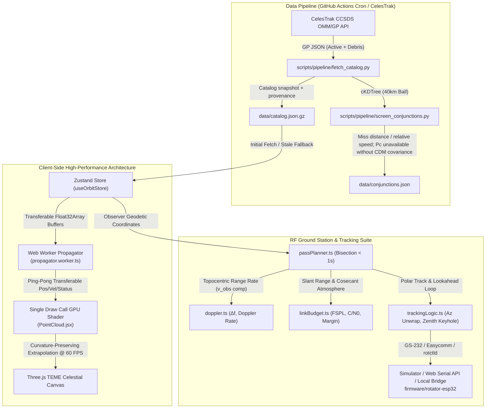

# OrbitGuard 🛰️
### Catalog-Based Orbit Predictions, Conjunction Screening & Ground Station Toolkit

[](https://orbit-guard-tan.vercel.app)
[](https://github.com/Hitesh070/Orbit-Guard/releases)
[](https://github.com/Hitesh070/Orbit-Guard)
[](https://celestrak.org)
[](https://reactjs.org/)
[](https://threejs.org/)
[](https://github.com/Hitesh070/Orbit-Guard)
[](LICENSE)

**OrbitGuard** propagates catalog GP/TLE orbital elements with SGP4 to show model-predicted positions and pass opportunities. Its catalog is a timestamped snapshot refreshed by scheduled pipeline runs and desktop fetch attempts; “real time” describes the simulation clock and derived predictions, not live sensor telemetry. Interpret each view using the displayed source timestamp and freshness state. Conjunction coverage is displayed only when a verified screening snapshot is loaded; collision probability is unavailable without measured covariance and hard-body data from an authoritative CDM. RF outputs require a known station location, selected pass, and verified mission inputs.

The packaged catalog snapshot currently contains 3,782 records (1,109 active satellites and 2,673 debris/rocket bodies) and was generated at `2026-11-08 04:16:07 UTC`. It is a fixed release asset and will age until refreshed; the app marks snapshots older than six hours as stale. Counts and availability vary with each accepted source snapshot.

---

## 🌐 Live Production Deployment & Subprojects

- **Production Web Application**: [https://orbit-guard-tan.vercel.app](https://orbit-guard-tan.vercel.app)
- **Windows Desktop Releases**: [GitHub Releases (NSIS Installer, Portable .exe, .zip)](https://github.com/Hitesh070/Orbit-Guard/releases)
- **Source Code**: [https://github.com/Hitesh070/Orbit-Guard](https://github.com/Hitesh070/Orbit-Guard)
- **Frontend Architecture**: [`frontend/README.md`](frontend/README.md)
- **Desktop Architecture & Hardening**: [`desktop/README.md`](desktop/README.md) | [`docs/DESKTOP_ARCHITECTURE.md`](docs/DESKTOP_ARCHITECTURE.md)
- **Backend & Pipeline Engine**: [`backend/README.md`](backend/README.md)
- **Windows Hardware & Serial Setup Guide**: [`docs/hardware/WINDOWS_SERIAL_SETUP.md`](docs/hardware/WINDOWS_SERIAL_SETUP.md)
- **Windows Testing & Verification Matrix**: [`docs/WINDOWS_TESTING.md`](docs/WINDOWS_TESTING.md)
- **ADR 003 (Electron Architecture Choice)**: [`docs/adr/003-electron-over-tauri.md`](docs/adr/003-electron-over-tauri.md)
- **90-Second Demo Presentation Script**: [`docs/DEMO_SCRIPT.md`](docs/DEMO_SCRIPT.md)
- **v5.0 Manual Review & Validation Report**: [`docs/RELEASE_V5.0.md`](docs/RELEASE_V5.0.md)

---

## 🏗️ System Architecture



---

## 🌟 Core Modules & Astrodynamics Rigor

### 1. High-Performance GPU Point Cloud & Curvature-Preserving Extrapolation
- **Propagation Offloading**: SGP4 math is offloaded to a dedicated Web Worker (`propagator.worker.ts`) using double-buffered transferable typed arrays (`Float32Array`), completely eliminating Garbage Collection (GC) pauses on the main thread.
- **Single Draw Call GPU Point-Sprite Shader**: Loaded catalog records with valid element sets render in one `THREE.Points` draw call.
- **Curvature-Preserving Spherical Shell Extrapolation**:
  At accelerated simulation speeds ($5\times, 15\times, 60\times$), naive linear extrapolation causes tangential blowout because straight-line steps diverge outward from circular orbit curvature:
  $$\|\mathbf{r}_{\text{linear}}(t)\| = \sqrt{r_0^2 + (v_0 \Delta t)^2} = r_0 \sqrt{1 + \left(\frac{v_0 \Delta t}{r_0}\right)^2} > r_0$$
  OrbitGuard projects the extrapolated position back onto the sphere radius:
  $$\mathbf{r}_{\text{curved}}(t) = \|\mathbf{r}_0\| \frac{\mathbf{r}_0 + \mathbf{v}_0 \Delta t}{\|\mathbf{r}_0 + \mathbf{v}_0 \Delta t\|}$$
  This mathematically guarantees **radial error is identically $0.000000\text{ m}$** at all warp speeds while maintaining fluid 60 FPS tangential motion.
- **Adaptive Worker Tick Rate**: Worker tick rate scales adaptively ($60\text{ms}$ at $60\times$, $100\text{ms}$ at $15\times$, $150\text{ms}$ at $5\times$, $500\text{ms}$ at $1\times$), preventing temporal lag between thread boundaries.
- **TEME Celestial Reference Frame**: Satellites propagate natively in the True Equator, Mean Equinox (TEME) inertial frame. Earth's surface rotates by Greenwich Mean Sidereal Time (GMST) with subsolar astronomical lighting.

### 2. Conjunction Screening Status
- The bundled v5.0 conjunction snapshot is explicitly withdrawn because its prior probability values relied on synthetic covariance. The app reports screening unavailable when no verified event snapshot is available.
- A zero-event or unavailable result does not establish that an orbit is clear. GP/TLE propagation can support screening candidates only when event coverage, epoch, and target scope are recorded and current.
- Collision probability is not reported without measured covariance and hard-body data from an authoritative CDM. No synthetic probability or risk score is substituted.

### 3. EEE/RF Ground Station Suite & Topocentric Doppler
- **Diurnal Earth-Rotation Tangential Velocity Compensation**: Range rate $\dot{\rho}$ explicitly accounts for observer motion in the inertial frame:
  $$\mathbf{v}_{\text{obs}} = [-\omega_E y_{\text{obs}}, \; \omega_E x_{\text{obs}}, \; 0]^T \quad (\omega_E = 7.292115 \times 10^{-5}\text{ rad/s})$$
  $$\dot{\rho} = \frac{(\mathbf{r}_{\text{sat}} - \mathbf{r}_{\text{obs}}) \cdot (\mathbf{v}_{\text{sat}} - \mathbf{v}_{\text{obs}})}{\|\mathbf{r}_{\text{sat}} - \mathbf{r}_{\text{obs}}\|}$$
- **Doppler Shift & Uplink Pre-Compensation**: Downlink shift $\Delta f = -f_0 \frac{\dot{\rho}}{c}$, central difference Doppler rate ($d(\Delta f)/dt$ in Hz/s), and uplink pre-compensation $f_{\text{tx}} = f_0 / (1 - \dot{\rho}/c)$.
- **Dynamic Link Budget (FSPL)**: Free-Space Path Loss ($20\log_{10}(d) + 20\log_{10}(f) + 32.44$), parabolic dish gain, beamwidth pointing loss, atmospheric cosecant attenuation, received power ($P_{\text{rx}}$), carrier-to-noise density ($C/N_0$), energy-per-bit ($E_b/N_0$), and margin profile along passes.
- **Polar Sky Plot & S-Curve Charts**: North-up circular SVG plot ($0^\circ\text{ to }360^\circ$ Azimuth, $0^\circ\text{ to }90^\circ\text{ Z}$ Elevation) with trajectory nodes, cleaned UTC time axis ticks, and one-click **RFC 5545 `.ics` calendar** and **`.csv` log** export.

### 4. Antenna Rotator Controller & Embedded Firmware Design
- **Unified Transport Abstraction**: Supports Virtual Simulator (default), Web Serial API (Chrome/Edge USB-CDC), and local WebSocket Bridge (`ws://127.0.0.1:8765`).
- **Protocols Supported**: Yaesu GS-232A/B (`W<AAA> <EEE>\r`), Easycomm I/II, and Hamlib `rotctld`.
- **Rotator Supervisor Logic**:
  - Cable wrap avoidance for $450^\circ$ rotators.
  - Zenith keyhole singularity handler ($>85^\circ$ elevation flip-mode or rate clamp).
  - 15-second communications loss watchdog timer and emergency stop (E-Stop).
- **Embedded ESP32 Reference Design**: PlatformIO firmware (`firmware/rotator-esp32/`, Arduino framework) with AccelStepper trapezoidal velocity profiling, TMC2209 step/dir drivers, home-switch referencing, and comms watchdog.

### 5. State Deep-Linking & Portaled Share System
- **Portal-Mounted Share Modal**: Uses React `createPortal` to mount directly into `document.body` at `z-[9999]`, preventing clipping or backdrop distortion from parent header containers. Includes responsive viewport clamping and keyboard Escape dismissal.
- **Deep-Link State Synchronization**: Synchronizes target spacecraft NORAD ID, simulation speed multiplier, and camera focus via URL search parameters for instantaneous state restoration.
- **Multi-Tier Clipboard Copy**: Modern `navigator.clipboard` integration with fallback to `document.execCommand('copy')` and clear visual confirmation.

---

## 🔬 Mathematical Verification & Benchmark Results

| Test Case / Benchmark | Target Requirement | Measured Output | Status |
|:---|:---|:---|:---:|
| **Vallado SGP4 Verification (113 Cases)** | Position error $< 1.0\text{ mm}$ | **$0.008\text{ mm}$** ($7.64 \times 10^{-9}\text{ km}$) | :white_check_mark: PASS |
| **Vallado SGP4 Velocity Error** | Velocity error $< 0.1\text{ mm/s}$ | **$0.001\text{ mm/s}$** ($7.27 \times 10^{-10}\text{ km/s}$) | :white_check_mark: PASS |
| **GPU Velocity Extrapolation (0.5s)** | Position drift bound $< 5\text{ m}$ | **$1.09\text{ m}$** ($1.09 \times 10^{-3}\text{ km}$) | :white_check_mark: PASS |
| **GPU Velocity Extrapolation (1.0s)** | Position drift bound $< 15\text{ m}$ | **$4.30\text{ m}$** ($4.30 \times 10^{-3}\text{ km}$) | :white_check_mark: PASS |
| **Curvature Extrapolation Radial Error (60x)** | Zero radial blowout ($< 0.001\text{ m}$) | **$0.000000\text{ m}$** | :white_check_mark: PASS |
| **Earth Rotation Velocity Compensation** | Equatorial $v_{\text{obs}}$ detection | **$465.1\text{ m/s}$** ($\Delta f \approx 680\text{ Hz}$ at UHF) | :white_check_mark: PASS |
| **FSPL 20·log10 Distance Scaling** | Doubling range adds $6.02\text{ dB}$ | **$6.0206\text{ dB}$** | :white_check_mark: PASS |
| **Bisection AOS/LOS Refinement** | Temporal convergence $< 1.0\text{ s}$ | **$< 0.5\text{ s}$** (15 iterations) | :white_check_mark: PASS |
| **Desktop IPC Security Contracts (16/16)** | Strict Zod validation on all IPC channels | **$100\%$ Rejected Malformed** | :white_check_mark: PASS |
| **Rotator Serial Safety Watchdog (10/10)** | 5 Hz clamp, 3s deadman E-Stop | **$100\%$ Failsafe Guaranteed** | :white_check_mark: PASS |

---

## ⚡ Quick Start & Local Development

### 1. Prerequisites
- **Node.js**: v20+ and `npm`
- **Python**: v3.11+ and `pip`

### 2. Web Development (Browser)
```bash
# Start frontend dev server
npm run dev:web
```
Open [http://localhost:5173](http://localhost:5173).

### 3. Windows Desktop Development (Electron + Hot Reload)
```bash
# Launch Electron dev environment with live Vite reload
npm run dev:desktop
```

### 4. Build Windows Installers & Packages
```bash
# Produces NSIS Setup, Portable .exe, and .zip in dist-desktop/
npm run dist:win
```

### 5. Run Test Suite
```bash
# Frontend + desktop suites (79 tests: 46 frontend + 33 desktop)
npm test

# Frontend Unit Tests (46 tests: SGP4, Extrapolation, Doppler, Link Budget)
npm run test:frontend

# Desktop IPC & Hardware Safety Tests (31 tests: Zod contracts, Serial Failsafes)
npm run test:desktop

# Backend tests (pytest reports the current count)
npm run test:backend
```

### 6. Optional: Run Local Antenna Rotator Bridge Daemon
```bash
python tools/orbitguard-bridge/bridge.py
```
Starts WebSocket server on `ws://127.0.0.1:8765` bridging to USB serial or internal GS-232 emulator. Note that on Windows Desktop, the built-in Native Serial and Hamlib rotctld options connect directly without needing this bridge daemon.

---

## ⚠️ Scientific Honesty & Operational Disclaimers
1. **Screening-Grade Notice**: TLE element sets degrade by $1\text{--}3\text{ km/day}$ for LEO objects due to unmodeled atmospheric density fluctuations.
2. **Covariance and Collision Probability**: Public element sets omit measured error covariance. OrbitGuard does not synthesize covariance or probability values. It is not an operational guidance system and must not be used for satellite maneuver decisions; use authoritative CDMs and operator procedures.
3. **RF Frequency Disclaimer**: OrbitGuard does not invent satellite frequencies. Frequencies are drawn from public amateur radio coordination databases (IARU, ARISS) and marked with verification status badges.

---

## 📜 License
OrbitGuard is released under the **MIT License**.
Satellite orbital elements provided courtesy of CelesTrak and Space-Track. Earth imagery courtesy of NASA Visible Earth (Blue Marble).
