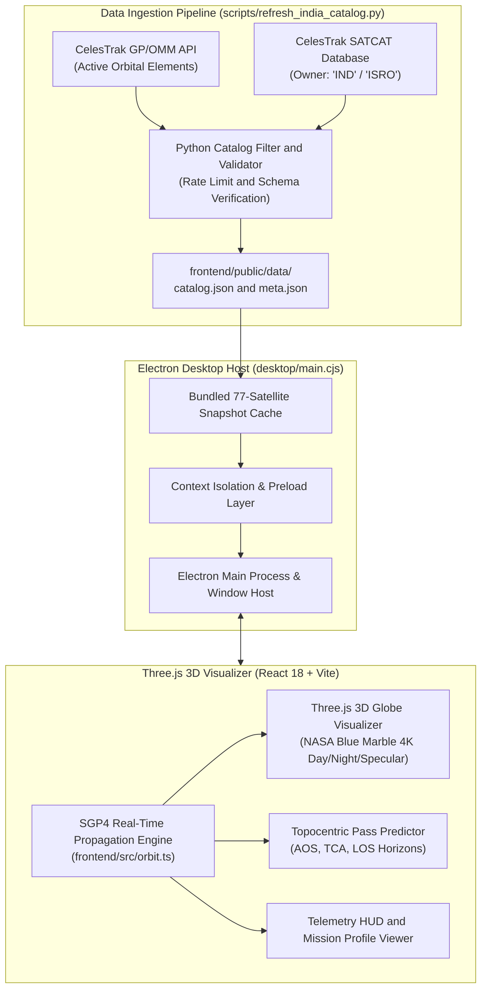
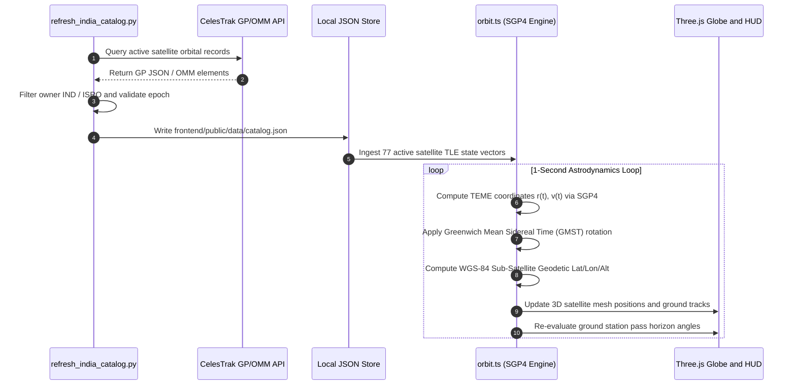

# ISRO Orbit Watch

<p align="center">
  
</p>

<p align="center">
  <b>Real-Time 3D Orbital Tracking & Ephemeris Visualization System for Indian Spacecraft</b><br>
  <i>Interactive 3D Earth globe tracking active payloads and satellites operated by the Indian Space Research Organisation (ISRO) using real-time SGP4 orbital propagation, true linear Earth-radius scaling, and automated CelesTrak data ingestion.</i>
</p>

<p align="center">
  
  
  
  
  
  
  <a href="LICENSE">
    
  </a>
</p>

---

## Table of Contents
- [1. Project Title & Overview](#1-project-title--overview)
- [2. Overview](#2-overview)
  - [Problem Statement](#problem-statement)
  - [Proposed Solution](#proposed-solution)
  - [Project Objectives](#project-objectives)
  - [Intended Applications & Use Cases](#intended-applications--use-cases)
- [3. Key Features](#3-key-features)
- [4. System Architecture](#4-system-architecture)
- [5. Technology Stack](#5-technology-stack)
- [6. Repository Structure](#6-repository-structure)
- [7. Hardware Requirements](#7-hardware-requirements)
- [8. Software Requirements](#8-software-requirements)
- [9. Installation and Setup](#9-installation-and-setup)
- [10. Usage Instructions](#10-usage-instructions)
- [11. System Workflow](#11-system-workflow)
- [12. API Documentation (CelesTrak Ingestion & IPC)](#12-api-documentation-celestrak-ingestion--ipc)
- [13. Results and Demonstration](#13-results-and-demonstration)
- [14. Configuration](#14-configuration)
- [15. Troubleshooting](#15-troubleshooting)
- [16. Future Improvements](#16-future-improvements)
- [17. Contributing](#17-contributing)
- [18. License](#18-license)
- [19. Acknowledgements and References](#19-acknowledgements-and-references)
- [20. Author / Project Maintainer](#20-author--project-maintainer)

---

## 1. Project Title & Overview

**ISRO Orbit Watch** is a space situational awareness (SSA) desktop visualization suite. Built with Electron 31, React 18, and Three.js, it computes and renders continuous orbital positions, forward ground sweeps, and topocentric ground-station pass schedules for active satellites launched and operated by India.

> [!NOTE]
> **Independent Astrodynamics Project**: This software is an independent engineering visualization tool and is not an official product of the Indian Space Research Organisation (ISRO). It utilizes publicly published orbital data from CelesTrak and verified satellite catalog metadata.

---

## 2. Overview

### Problem Statement
Standard orbital tracking applications suffer from three recurring visualization shortcomings:
1. **Distorted Non-Linear Scales**: Satellite altitudes are exaggerated by 5× to 20× to look prominent, completely distorting true orbital geometries between Low Earth Orbit (LEO) and Geostationary Orbit (GEO).
2. **Generic Global Catalogs**: Massive catalogs contain thousands of dead debris fragments, cluttering displays and obscuring national space mission monitoring.
3. **Black-Box Ephemeris Calculations**: Many tools use coarse circular approximations rather than rigorous Simplified General Perturbations (SGP4) mathematical modeling accounting for Earth oblateness ($J_2$) and atmospheric drag.

### Proposed Solution
ISRO Orbit Watch solves these limitations through:
- **True Physical Proportionality**: Renders satellite altitudes strictly to scale relative to the Earth's radius ($1.0\text{ unit} = 6,378.137\text{ km}$). The dynamic Three.js camera smoothly reframes between LEO ($300-800\text{ km}$) and GEO ($35,786\text{ km}$).
- **Filtered Indian Catalog**: An automated Python ingestion pipeline filters CelesTrak SATCAT records matching ownership keys `IND` and `ISRO`, providing verified records for communications (GSAT, INSAT), navigation (NavIC), Earth observation (Cartosat, RISAT, Oceansat), and deep space heritage missions.
- **Client-Side SGP4 Engine**: Evaluates true geopotential harmonics ($J_2, J_3, J_4$), computes Greenwich Mean Sidereal Time (GMST) rotation, and converts coordinates to geodetic WGS-84 coordinates on a 1-second refresh cycle.

### Project Objectives
- Render photorealistic 4K Earth visuals (daytime surface, nighttime city lights, volumetric clouds, and specular ocean reflections) at a steady 60 FPS.
- Deliver topocentric ground-pass predictions (AOS, TCA, LOS) for any user-defined ground station coordinates.
- Maintain an offline catalog fallback ensuring mission visibility during network blackouts.

### Intended Applications & Use Cases
- Amateur satellite tracking and VHF/UHF antenna pointing.
- Aerospace engineering education and astrodynamics instruction.
- Public visualization of India's space program and constellation deployments.

---

## 3. Key Features

- **Photorealistic NASA Blue Marble 3D Globe**: Rendered via Three.js with 4096×2048 daytime surface textures, night city lights, dynamic volumetric cloud layer, ocean specular reflection maps, and starfield.
- **True Linear Scaling**: Physical proportions preserved ($R_E = 6378.137\text{ km}$). Geostationary satellite rings are rendered at their true physical distance of $\approx 6.6\ R_E$.
- **Real-Time SGP4 Astrodynamics**: Re-evaluates satellite Cartesian position, velocity vectors, instantaneous altitude, and ground footprint every 1,000 ms.
- **One-Orbit Forward Ground Track**: Dynamically computes and projects the spacecraft's next complete orbital path across the planetary surface.
- **Topocentric Ground Station Pass Predictor**: Calculates Acquisition of Signal (AOS), Time of Closest Approach (TCA), Loss of Signal (LOS), and maximum horizon elevation angle for any observer latitude/longitude.
- **Verified Spacecraft Profiles**: Displays launch vehicle (PSLV, GSLV, LVM3), launch date, apogee, perigee, inclination, and links to official ISRO archives (Upagrah and Bhoonidhi).
- **Autonomous Data Refresh Pipeline**: GitHub Actions CI/CD and local Python pipeline automatically fetching latest CelesTrak GP/OMM JSON feeds while strictly respecting CelesTrak's 2-hour rate limits.

---

## 4. System Architecture



### Astrodynamics & Mathematical Modeling

#### 1. Simplified General Perturbations (SGP4)
Ingests two-line elements and OMM state records, accounting for secular and periodic gravitational perturbations ($J_2, J_3, J_4$), atmospheric drag ($B^*$), and third-body lunisolar gravity:

```math
\mathbf{r}_{\text{TEME}}(t), \quad \mathbf{v}_{\text{TEME}}(t) = \text{SGP4}\left(\text{TLE}, \; t - t_0\right)
```

#### 2. TEME to Earth-Centered Earth-Fixed (ECEF) Rotation
Rotates state vectors from the True Equator, Mean Equinox (TEME) inertial frame into the rotating Greenwich geographic frame using Greenwich Mean Sidereal Time ($\theta_{\text{GMST}}$):

```math
\mathbf{r}_{\text{ECEF}} = \mathbf{R}_z(\theta_{\text{GMST}}) \, \mathbf{r}_{\text{TEME}}
```

```math
\begin{bmatrix}
x_{\text{ECEF}} \\
y_{\text{ECEF}} \\
z_{\text{ECEF}}
\end{bmatrix}
=
\begin{bmatrix}
\cos\theta_{\text{GMST}} & \sin\theta_{\text{GMST}} & 0 \\
-\sin\theta_{\text{GMST}} & \cos\theta_{\text{GMST}} & 0 \\
0 & 0 & 1
\end{bmatrix}
\begin{bmatrix}
x_{\text{TEME}} \\
y_{\text{TEME}} \\
z_{\text{TEME}}
\end{bmatrix}
```

#### 3. Geodetic Sub-Satellite Point (WGS-84 Ellipsoid)
Transforms Cartesian ECEF coordinates into geodetic latitude ($\phi$), longitude ($\lambda$), and ellipsoidal altitude ($h$) over the WGS-84 reference ellipsoid ($a = 6378.137\text{ km}$, $f = 1 / 298.257223563$).

---

## 5. Technology Stack

### Programming Languages
- **TypeScript**: Type-safe 3D rendering components, SGP4 math algorithms, and telemetry data models.
- **JavaScript (ES6+)**: Electron desktop host runtime and Vite configurations.
- **Python 3.10+**: Autonomous orbital data ingestion, SATCAT parsing, and smoke testing.

### Frameworks & Libraries
- **Desktop Shell**: Electron 31 (Chromium 126 / Node.js 20).
- **3D Graphics**: Three.js (r165), `@react-three/fiber`, `@react-three/drei`.
- **Frontend Framework**: React 18, Vite 5, Tailwind CSS, Lucide React icons.
- **Astrodynamics**: Custom SGP4 implementation conforming to AIAA 2006 Spacetrack Report #3.

---

## 6. Repository Structure

```text
ISRO-Orbit-Watch/
├── desktop/                         # Electron desktop host
│   └── main.cjs                     # Electron main process, window creation & IPC handlers
├── docs/                            # Engineering documentation & validation manuals
│   ├── DATA_SOURCES.md              # Upstream CelesTrak & ISRO data provenance
│   ├── USER_GUIDE.md                # End-user operational manual
│   └── VALIDATION.md                # SGP4 verification & accuracy benchmarks
├── frontend/                        # React 18 + TypeScript + Three.js application
│   ├── public/                      # Static textures & bundled catalog data
│   │   ├── data/                    # Bundled JSON data stores
│   │   │   ├── catalog.json         # Active Indian satellite orbital elements (77 payloads)
│   │   │   ├── meta.json            # Data snapshot timestamp & source metadata
│   │   │   └── satcat-india.json    # SATCAT Indian ownership mappings
│   │   └── textures/                # NASA Blue Marble 4K Earth textures & starfield
│   ├── src/                         # Application source code
│   │   ├── App.tsx                  # Main telemetry interface & search shell
│   │   ├── Globe.tsx                # Three.js 3D Earth globe & orbit path renderer
│   │   ├── orbit.ts                 # SGP4 propagation, GMST transforms & pass prediction
│   │   ├── missionProfiles.ts       # Verified ISRO mission summaries & image links
│   │   ├── styles.css               # Clean aerospace dark-mode design system
│   │   ├── types.ts                 # TypeScript interfaces for orbits & spacecraft
│   │   └── main.tsx                 # React DOM bootstrapping
│   ├── package.json                 # Frontend dependencies (React, Three.js, Lucide)
│   ├── tsconfig.json                # TypeScript compiler configuration
│   └── vite.config.ts               # Vite bundler configuration
├── resources/                       # Desktop application icons
│   └── icon.ico                     # Multi-resolution Windows desktop icon
├── scripts/                         # Pipeline & verification scripts
│   ├── refresh_india_catalog.py     # CelesTrak GP/OMM fetcher & SATCAT filter
│   └── orbit_smoke.mjs              # Automated orbit propagation smoke test
├── .github/workflows/               # GitHub Actions CI/CD workflows
│   └── refresh-data.yml             # Bi-hourly automated data refresh workflow
├── .gitignore                       # Git ignore rules
├── LICENSE                          # MIT License File
├── package.json                     # Monorepo build scripts & Electron builder config
├── package-lock.json                # Deterministic package lockfile
├── requirements.txt                 # Python dependencies for data pipeline
└── README.md                        # Master repository documentation
```

---

## 7. Hardware Requirements

| Component | Minimum Specification | Recommended Specification |
| :--- | :--- | :--- |
| **Processor** | Dual-Core Intel/AMD x86_64 @ 2.0 GHz | Quad-Core Intel Core i5 / AMD Ryzen 5 |
| **Memory (RAM)** | 4 GB RAM | 8 GB RAM |
| **Graphics (GPU)**| Integrated Intel HD 4000 / WebGL 2.0 | Dedicated NVIDIA / AMD GPU (DirectX 11+) |
| **Storage** | 500 MB free disk space | 1 GB free SSD storage |
| **Display** | 1366×768 resolution | 1920×1080 (Full HD) or higher |

---

## 8. Software Requirements

- **Operating System**: Windows 10 (64-bit) or Windows 11 (64-bit).
- **Node.js**: Node.js v20.x or higher with `npm`.
- **Python**: Python 3.10+ (for catalog refresh pipeline).
- **CelesTrak Access**: Standard outbound HTTPS access to `celestrak.org` (for live element updates).

---

## 9. Installation and Setup

### 1. Repository Cloning
```powershell
git clone https://github.com/Hitesh070/ISRO-Orbit-Watch.git
cd ISRO-Orbit-Watch
```

### 2. Dependency Installation
```powershell
# Install root packaging dependencies
npm install

# Install React & Three.js frontend dependencies
npm --prefix frontend install

# Install Python data pipeline dependencies
pip install -r requirements.txt
```

### 3. Build Web Bundle
```powershell
npm run build:web
```

---

## 10. Usage Instructions

### 1. Launching Desktop Application
```powershell
npm start
```

### 2. Compiling Windows Standalone Executable (.exe)
To package an installer and portable binary:
```powershell
npm run dist:win
```
The resulting executable is generated in the `release/` folder.

### 3. Running Automated Orbit Smoke Tests
Verify SGP4 propagation consistency across all 77 bundled satellites:
```powershell
npm run check:orbit
```

### 4. Refreshing Orbital Elements from CelesTrak
```powershell
python scripts/refresh_india_catalog.py
```
> The script automatically respects CelesTrak's 2-hour rate-limiting policy and rejects malformed records.

---

## 11. System Workflow



---

## 12. API Documentation (CelesTrak Ingestion & IPC)

### Upstream CelesTrak Data Feeds
- **Endpoint**: `https://celestrak.org/NORAD/elements/gp.php?GROUP=active&FORMAT=json`
- **Cadence**: Cached locally; refreshed at most once every 2 hours per CelesTrak policy.
- **Fields Processed**: `OBJECT_NAME`, `NORAD_CAT_ID`, `EPOCH`, `INCLINATION`, `RA_OF_ASC_NODE`, `ECCENTRICITY`, `ARG_OF_PERICENTER`, `MEAN_ANOMALY`, `MEAN_MOTION`, `BSTAR`.

### Electron Inter-Process Communication (IPC)
- **`app:get-catalog`**: Returns the active in-memory 77-payload catalog array.
- **`app:get-version`**: Returns the current desktop release tag (`v6.0`).

---

## 13. Results and Demonstration

- **True-Scale Linear Geometry**: Renders Low Earth Orbit (LEO) clusters close to the planet skin while Geostationary (GEO) communication satellites reside in a wide orbital ring at $35,786\text{ km}$ ($6.6\ R_E$).
- **Day/Night Shader Transition**: The Earth globe features a smooth dynamic terminator separating daylight surface maps from illuminated nighttime city lights.
- **One-Orbit Ground Tracks**: Continuous sinusoidal ground sweeps visualized across the surface map illustrating orbital inclination and nodal precession.

---

## 14. Configuration

Key orbital constants in `frontend/src/orbit.ts`:

```typescript
export const WGS84 = {
  a: 6378.137,              // Earth equatorial radius in kilometers
  f: 1.0 / 298.257223563,   // Flattening factor
  b: 6356.7523142,          // Polar semi-minor axis
  omega_e: 7.292115e-5      // Earth rotation rate (rad/s)
};

export const REFRESH_INTERVAL_MS = 1000; // 1-second ephemeris clock
```

---

## 15. Troubleshooting

1. **Black Globe Screen / WebGL Failure**:
   - *Cause*: GPU driver acceleration disabled or WebGL context crashed.
   - *Fix*: Update graphics drivers. In Electron, ensure hardware acceleration is enabled in `desktop/main.cjs`.
2. **CelesTrak Rate Limit Error (`HTTP 429 Too Many Requests`)**:
   - *Cause*: Ingestion script executed more frequently than once every 2 hours.
   - *Fix*: The application falls back to `catalog.json` snapshot automatically. Do not bypass the 2-hour rate limiter.
3. **Ground Pass Elevation Always Negative**:
   - *Cause*: Spacecraft is below the local geometric horizon for the entered observer latitude/longitude.
   - *Fix*: Use the satellite selector to inspect an overhead satellite or reduce the elevation angle threshold.

---

## 16. Future Improvements

- [ ] **Orbital Decay Forecasting**: Numerical integration estimating atmospheric re-entry timeframes for low-altitude payloads.
- [ ] **Solar Illumination Angle Calculation**: Real-time vector angle between satellite solar panels and the Sun vector.
- [ ] **Inter-Satellite Laser Cross-Link Geometry**: Optical line-of-sight visibility modeling between orbiting NavIC nodes.

---

## 17. Contributing

1. Fork the repository.
2. Create your feature branch: `git checkout -b feature/orbital-decay-model`.
3. Commit your changes: `git commit -m "feat: add SGP4 orbital decay estimator"`.
4. Push to branch: `git push origin feature/orbital-decay-model`.
5. Open a Pull Request.

---

## 18. License

This project is licensed under the [MIT License](LICENSE).

---

## 19. Acknowledgements and References

- **CelesTrak** (Dr. T.S. Kelso) for General Perturbations (GP) orbital data.
- **NASA Earth Observatory** for Blue Marble Next Generation textures.
- *Fundamentals of Astrodynamics and Applications* by David A. Vallado for SGP4 implementation guidance.
- **ISRO Bhoonidhi & Upagrah Archives** for mission metadata verification.

---

## 20. Author / Project Maintainer

- **Developer**: Hitesh V S
- **GitHub**: [@Hitesh070](https://github.com/Hitesh070)
