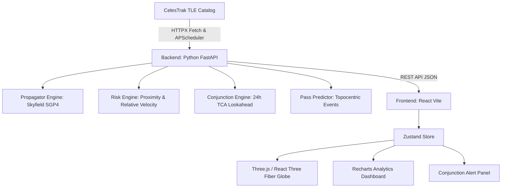

# OrbitGuard 🛰️
### Real-Time Satellite Orbit Tracker & Space Debris Risk Dashboard

[](https://fastapi.tiangolo.com)
[](https://rhodesmill.org/skyfield/)
[](https://reactjs.org/)
[](https://threejs.org/)
[](https://tailwindcss.com/)

**OrbitGuard** is a full-stack space situational awareness (SSA) platform engineered to track operational spacecraft and space debris in real time, evaluate conjunction collision probabilities, and model orbital debris density across Low Earth Orbit (LEO), Medium Earth Orbit (MEO), and Geostationary Orbit (GEO).

---

## 🌟 Key Features

### 1. Real-Time 3D Earth Globe & Trajectory Renderer
- High-fidelity 3D Earth mesh rendered with Three.js and React Three Fiber (`@react-three/fiber`, `@react-three/drei`).
- Textured using NASA Blue Marble day map, city night lights emissive map, rotating cloud atmosphere layer, and Rayleigh scattering glow.
- Color-coded satellite dots:
  - 🟢 **Safe** (Risk Score < 35)
  - 🟡 **Caution** (Risk Score 35–69)
  - 🔴 **High Risk / Critical** (Risk Score ≥ 70)
  - 🟠 **Space Debris / Upper Stages**
- Interactive click-to-inspect satellite card with full telemetry: altitude, velocity, inclination, orbital period, country/agency, subpoint coordinates, and apogee/perigee.
- 3D glowing Keplerian orbit paths rendered along 180 sampled points per revolution.

### 2. SGP4 Real-Time Orbital Propagation Engine (Python / Skyfield)
- Ingests Two-Line Element (TLE) sets from CelesTrak.
- Automated background synchronization every 6 hours via `APScheduler` with offline seed fallbacks.
- SGP4 propagation calculates instantaneous latitude, longitude, altitude, velocity vectors, and normalized Cartesian coordinates.
- Special tracking of Indian Space Research Organisation (ISRO) spacecraft: Cartosat-2B, Cartosat-3, RISAT-2BR1, EOS-04, GSAT-30, INSAT-3DR, and NavIC/IRNSS.

### 3. Space Debris Risk Engine
- Implements quantitative conjunction risk scoring:
  $$\text{Risk Score} = \frac{\text{nearby\_count} \times \bar{v}_{\text{rel}}}{\text{altitude\_factor}}$$
- Computes proximity shells (within 80 km), relative encounter velocities (km/s), and collision probabilities.
- Dynamic flight dynamics advisory: Collision Avoidance Maneuver (CAM) delta-v recommendations.
- Interactive Sortable Table of Top 10 highest-risk satellites.

### 4. 24-Hour Conjunction Alert System
- Screens close approaches bringing objects within $<30\text{ km}$ miss distance over a rolling 24-hour horizon.
- Live countdown timers ticking down to Time of Closest Approach (TCA).
- One-click 3D visualization highlighting both encountering objects on the globe.

### 5. Ground Station Pass Predictor
- Predicts upcoming pass opportunities (AOS, Culmination/Max Elevation, LOS) over pre-configured space centers (Bengaluru ISTRAC, Sriharikota SDSC, New Delhi, Houston JSC, Cape Canaveral) or custom coordinates.
- Computes topocentric trajectory azimuths, duration, and 2D ground track coordinate polylines.

### 6. Analytics & Statistics Dashboard
- Macro population breakdown (Operational Spacecraft vs Debris Fragments vs Spent Rocket Bodies).
- Altitude distribution histogram.
- Space Age launch growth chart (1957–present) depicting historical ASAT and collision events.
- Top 10 spacefaring nations distribution.
- 2D Altitude $\times$ Inclination collision density heatmap.

---

## 🏗️ Architecture & Tech Stack



---

## 🚀 Quickstart Guide

### Prerequisites
- Python 3.10+
- Node.js 18+ and npm

---

### Step 1: Run the Backend (FastAPI)

1. Navigate to the backend directory:
   ```bash
   cd backend
   ```
2. Create and activate a Python virtual environment:
   ```bash
   # On Windows
   python -m venv venv
   .\venv\Scripts\activate

   # On Linux / macOS
   python3 -m venv venv
   source venv/bin/activate
   ```
3. Install dependencies:
   ```bash
   pip install -r requirements.txt
   ```
4. Start the FastAPI server:
   ```bash
   uvicorn main:app --reload --host 0.0.0.0 --port 8000
   ```
   Backend will be live at `http://localhost:8000`. Interactive Swagger API docs are available at `http://localhost:8000/docs`.

---

### Step 2: Run the Frontend (React / Vite)

1. In a new terminal, navigate to the frontend directory:
   ```bash
   cd frontend
   ```
2. Install npm dependencies:
   ```bash
   npm install
   ```
3. Start the Vite development server:
   ```bash
   npm run dev
   ```
4. Open `http://localhost:5173` in your browser.

---

### Running with Docker Compose (Optional)

```bash
docker-compose up --build
```
- Frontend: `http://localhost:5173`
- Backend API: `http://localhost:8000`

---

## 📡 API Reference Summary

| Endpoint | Method | Description |
|---|---|---|
| `/` | `GET` | Health check & system manifest |
| `/api/satellites` | `GET` | All operational satellites with real-time positions & risk scores |
| `/api/satellite/{norad_id}` | `GET` | Satellite telemetry, risk profile & 3D orbit trajectory path |
| `/api/debris` | `GET` | Cataloged space debris & rocket bodies |
| `/api/risk` | `GET` | Top 10 high-risk satellites, shell counts, and heatmap |
| `/api/risk/{norad_id}` | `GET` | Detailed risk breakdown and CAM maneuver recommendation |
| `/api/conjunctions` | `GET` | Predicted close-approach warnings over next 24 hours |
| `/api/passes` | `GET` | Ground station pass predictions (AOS/LOS/El) & ground track |
| `/api/analytics` | `GET` | Macro analytics, altitude histogram, country rankings |
| `/api/ground-stations` | `GET` | Curated global space centers and ground stations |
| `/api/refresh` | `POST` | Trigger immediate CelesTrak TLE refresh |

---

## 🎓 Resume Highlights (ISRO / HAL Presentation Points)

- **Astrodynamics & Orbital Mechanics**: Implementation of standard Simplified General Perturbations-4 (SGP4) analytical propagation model accounts for Earth oblateness ($J_2, J_3, J_4$), atmospheric drag decay, and lunar/solar gravitational perturbations.
- **Conjunction Assessment & CAM**: Models Euclidean miss distances and relative velocity vectors at Time of Closest Approach (TCA), translating quantitative metrics into actionable Collision Avoidance Maneuver (CAM) delta-v budgets.
- **Modern Full-Stack Engineering**: High-throughput asynchronous backend built with FastAPI, paired with React Three Fiber shader-level rendering, Zustand state orchestration, and responsive Tailwind UI.
