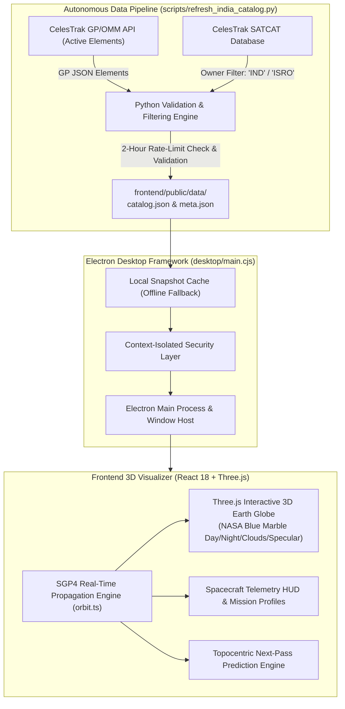

# ISRO Orbit Watch

<p align="center">
  
</p>

<p align="center">
  <b>Real-Time 3D Orbital Tracking & Ephemeris Visualization System for Indian Spacecraft</b><br>
  <i>Interactive Earth globe tracking active payloads and satellites operated by the Indian Space Research Organisation (ISRO) using real-time SGP4 orbital propagation, true linear Earth-radius scaling, and automated CelesTrak data ingestion.</i>
</p>

<p align="center">
  
  
  
  
  
  
  <a href="LICENSE">
    
  </a>
</p>

---

## Table of Contents
- [Executive Overview](#executive-overview)
- [System Architecture](#system-architecture)
- [Key Features & Capabilities](#key-features--capabilities)
- [Astrodynamics & Mathematical Modeling](#astrodynamics--mathematical-modeling)
- [Repository Structure](#repository-structure)
- [Quick Start & Build Instructions](#quick-start--build-instructions)
  - [1. Prerequisites](#1-prerequisites)
  - [2. Local Development & Launch](#2-local-development--launch)
  - [3. Packaging Standalone Windows Executable (.exe)](#3-packaging-standalone-windows-executable-exe)
  - [4. Manual Catalog Refresh](#4-manual-catalog-refresh)
  - [5. Orbit Smoke Test](#5-orbit-smoke-test)
- [Data Provenance & Honest Limitations](#data-provenance--honest-limitations)
- [Author & License](#author--license)

---

## Executive Overview

**ISRO Orbit Watch** is a dedicated Windows desktop application designed to visualize and track satellites and payloads launched and operated by India. It propagates public General Perturbations (GP) and Orbit Mean-Elements Message (OMM) orbital element sets using the standard SGP4 algorithm to compute real-time spacecraft coordinates, instantaneous altitudes, velocity vectors, and one-orbit forward ground tracks.

> [!NOTE]
> **Independent Astrodynamics Project**: This software is an independent engineering visualization tool and is not an official product of the Indian Space Research Organisation (ISRO). It utilizes publicly published orbital data from CelesTrak and satellite catalog metadata.

---

## System Architecture



---

## Key Features & Capabilities

### 1. High-Fidelity 3D Earth Celestial Engine
* **NASA Blue Marble Imagery**: Photorealistic Earth rendering featuring 4096×2048 daytime surface textures, night city lights, dynamic volumetric cloud layers, ocean specular reflection maps, and a celestial starfield.
* **True Physical Linear Scale**: Satellite altitudes are plotted at true linear Earth-radius proportions ($1.0\text{ scene unit} = 6,378.137\text{ km}$). The camera dynamically pulls back when framing geostationary orbits (GEO) so the complete orbital geometry remains visually accurate.
* **Greenwich Sidereal Time Rotation**: The Earth rotates synchronously according to Greenwich Mean Sidereal Time (GMST).

### 2. Live SGP4 Ephemeris Propagation
* **1-Second Refresh Clock**: Re-evaluates true satellite position, velocity, altitude, and ground footprint every second.
* **Predicted Ground Path**: Dynamically traces a full 1-orbit forward ground track showing the satellite's orbital plane and upcoming planetary sweep.
* **Catalog Coverage**: Indexes Indian communication (GSAT, INSAT), navigation (NavIC / IRNSS), Earth observation (Cartosat, Resourcesat, Oceansat, RISAT), and scientific exploration missions (Aditya-L1, Chandrayaan, and Mars Orbiter Mission heritage).

### 3. Mission Profiles & Spacecraft Telemetry
* **Verified Mission Cards**: Displays confirmed launch dates, launch vehicles (PSLV, GSLV, LVM3), apogee/perigee altitudes, orbital inclinations, orbital periods, and official spacecraft imagery.
* **Truth in Data**: Unknown facts, unverified payloads, and missing imagery are explicitly labeled rather than guessed or fabricated.
* **Official Data Portal Links**: Direct integration links to ISRO's **Upagrah** tracker and public Earth-observation archives (**Bhoonidhi**).

### 4. Topocentric Ground Station Pass Predictor
* **Observer Location Calculator**: Input custom ground observer coordinates (latitude, longitude, altitude) and elevation threshold angles.
* **Pass Timeline**: Predicts Acquisition of Signal (AOS), Time of Closest Approach (TCA), Loss of Signal (LOS), and maximum elevation angle.

### 5. Resilient Data Pipeline & Offline Cache
* **Strict CelesTrak Cadence Enforcement**: Automatically respects CelesTrak's two-hour GP request rate policy, caching verified data locally.
* **Offline Fallback**: In the event of network disruption, the application seamlessly reverts to the bundled 77-record validated catalog snapshot (`frontend/public/data/catalog.json`).

---

## Astrodynamics & Mathematical Modeling

### 1. Simplified General Perturbations (SGP4)
The application ingests standardized two-line elements and OMM state records, evaluating gravitational perturbations ($J_2, J_3, J_4$), atmospheric drag ($B^*$), and third-body lunisolar gravitational effects:
$$\mathbf{r}_{\text{TEME}}(t), \; \mathbf{v}_{\text{TEME}}(t) = \text{SGP4}\left(\text{TLE}, \; t - t_0\right)$$

### 2. TEME to Earth-Centered Earth-Fixed (ECEF) Transformation
Coordinates are rotated from the True Equator, Mean Equinox (TEME) inertial frame into the rotating Greenwich geographic reference frame using Greenwich Mean Sidereal Time ($\theta_{\text{GMST}}$):
$$\begin{bmatrix} x_{\text{ECEF}} \\ y_{\text{ECEF}} \\ z_{\text{ECEF}} \end{bmatrix} = \begin{bmatrix} \cos\theta_{\text{GMST}} & \sin\theta_{\text{GMST}} & 0 \\ -\sin\theta_{\text{GMST}} & \cos\theta_{\text{GMST}} & 0 \\ 0 & 0 & 1 \end{bmatrix} \begin{bmatrix} x_{\text{TEME}} \\ y_{\text{TEME}} \\ z_{\text{TEME}} \end{bmatrix}$$

### 3. Geodetic Sub-Satellite Point (WGS-84 Ellipsoid)
Transforms Cartesian ECEF coordinates into geodetic latitude ($\phi$), longitude ($\lambda$), and altitude ($h$) over the WGS-84 reference ellipsoid ($a = 6378.137\text{ km}$, $f = 1/298.257223563$).

---

## Repository Structure

```text
ISRO-Orbit-Watch/
├── desktop/                         # Electron desktop shell
│   └── main.cjs                     # Electron main process, window management & IPC
├── docs/                            # Engineering documentation & data provenance
│   ├── DATA_SOURCES.md              # Upstream CelesTrak & ISRO data sources
│   ├── USER_GUIDE.md                # End-user operations & features manual
│   └── VALIDATION.md                # SGP4 verification & accuracy benchmarks
├── frontend/                        # React 18 + TypeScript + Three.js application
│   ├── public/                      # Static textures & bundled catalog data
│   │   ├── data/                    # JSON data stores
│   │   │   ├── catalog.json         # Active Indian satellite orbital elements (77 records)
│   │   │   ├── meta.json            # Data snapshot timestamp & provenance metadata
│   │   │   └── satcat-india.json    # SATCAT Indian ownership mappings
│   │   └── textures/                # NASA Blue Marble 4K Earth textures & starfield
│   ├── src/                         # Application source code
│   │   ├── App.tsx                  # Main telemetry interface & search shell
│   │   ├── Globe.tsx                # Three.js 3D Earth globe & orbit path renderer
│   │   ├── orbit.ts                 # SGP4 propagation, GMST transforms & pass prediction
│   │   ├── missionProfiles.ts       # Verified ISRO mission summaries & image links
│   │   ├── styles.css               # Clean aerospace dark-mode design system
│   │   ├── types.ts                 # TypeScript interfaces for orbits & spacecraft
│   │   └── main.tsx                 # React DOM bootstrapping
│   ├── package.json                 # Frontend dependencies (React, Three.js, Lucide)
│   ├── tsconfig.json                # TypeScript compiler configuration
│   └── vite.config.ts               # Vite bundler configuration
├── resources/                       # Desktop application icons
│   └── icon.ico                     # Multi-resolution Windows desktop icon
├── scripts/                         # Pipeline & verification scripts
│   ├── refresh_india_catalog.py     # CelesTrak GP/OMM fetcher & SATCAT filter
│   └── orbit_smoke.mjs              # Automated orbit propagation smoke test
├── .github/workflows/               # GitHub Actions CI/CD workflows
│   └── refresh-data.yml             # Bi-hourly automated data refresh workflow
├── .gitignore                       # Git ignore rules
├── LICENSE                          # MIT License File
├── package.json                     # Monorepo build scripts & Electron builder config
├── package-lock.json                # Deterministic package lockfile
├── requirements.txt                 # Python dependencies for data pipeline
└── README.md                        # Master repository documentation
```

---

## Quick Start & Build Instructions

### 1. Prerequisites
- **Node.js**: v20 or higher with `npm`
- **Python**: v3.10 or higher with `pip`
- **Operating System**: Windows 10 or 11 (x64)

### 2. Local Development & Launch
```powershell
# 1. Clone the repository
git clone https://github.com/Hitesh070/ISRO-Orbit-Watch.git
cd ISRO-Orbit-Watch

# 2. Install root and frontend dependencies
npm install
npm --prefix frontend install

# 3. Install Python pipeline dependencies
pip install -r requirements.txt

# 4. Build the web frontend
npm run build:web

# 5. Launch the Electron desktop application
npm start
```

### 3. Packaging Standalone Windows Executable (.exe)
To compile a standalone installer and portable Windows executable:
```powershell
npm run dist:win
```
The resulting installation files (`.exe` installer and portable binaries) are generated in the `release/` directory.

### 4. Manual Catalog Refresh
To manually fetch and validate the latest orbital data from CelesTrak:
```powershell
python scripts/refresh_india_catalog.py
```
> The script automatically enforces CelesTrak's 2-hour rate-limiting policy and rejects malformed records.

### 5. Orbit Smoke Test
To run the automated verification test on the bundled catalog:
```powershell
npm run check:orbit
```

---

## Data Provenance & Honest Limitations

1. **Orbital Data Source**: Orbital parameters are retrieved via CelesTrak's GP/OMM data service and matched with SATCAT ownership records (`IND` and `ISRO`).
2. **Propagated Estimates**: Orbital positions are computed via SGP4 mathematical extrapolation from the element epoch; they do not represent real-time downlinked telemetry.
3. **No General Downlink Feed**: Official ISRO portals such as Bhoonidhi and Upagrah publish processed science and Earth-observation data rather than public engineering telemetry feeds.
4. **Collision Avoidance Disclaimer**: This software is intended strictly for educational, research, and amateur tracking purposes and must not be used for operational spacecraft maneuvering or collision avoidance decisions.

---

## Author & License

- **Developer**: Hitesh V S
- **GitHub**: [@Hitesh070](https://github.com/Hitesh070)
- **License**: Released under the [MIT License](LICENSE).
